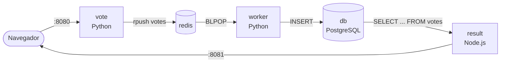

<div align="center">

# 🗳️ Voting App "Santa Cruz"

**Aplicación multicontenedor con Docker Compose**

Proyecto 03 · Infraestructura y Seguridad Computacional · Universidad de Ibagué


[Requisitos](#-requisitos) · [Arranque rápido](#-arranque-rápido) · [Estructura](#-estructura-del-proyecto) · [Docker Hub y GitHub](#-publicación-en-docker-hub-criterio-7) · [Rúbrica](#-cómo-se-comprueba-la-rúbrica) · [Problemas](#️-problemas-frecuentes)

</div>

---

Proyecto de la entrega: una aplicación web distribuida en **5 contenedores**
(orquestados con un único `docker-compose.yml`), basada en el ejemplo oficial
de Docker [`example-voting-app`](https://github.com/dockersamples/example-voting-app).



> `vote` y `result` están en la red **front-tier** (lo que ve el navegador). Todos los servicios están en **back-tier**.

| Servicio  | Tecnología                     | Rol                                         | Puerto |
|-----------|--------------------------------|---------------------------------------------|:------:|
| `vote`    | Python 3.11 + Flask            | Web de votación, encola los votos en Redis  | 8080   |
| `result`  | Node.js 20 + Express/socket.io | Muestra los resultados en tiempo real       | 8081   |
| `worker`  | Python 3.11                    | **Procesa** los votos: Redis → PostgreSQL   | —      |
| `redis`   | Redis 7 (AOF)                  | Cola de votos                               | —      |
| `db`      | PostgreSQL 16                  | Almacén permanente de los votos             | —      |

---

## 📋 Requisitos

- Docker Desktop instalado y abierto (incluye Docker Compose v2).
- Git para clonar el repositorio.
- Una cuenta gratuita en [Docker Hub](https://hub.docker.com) para publicar.
- Una cuenta de GitHub para subir el código.

---

## 🚀 Arranque rápido

```bash
# 0. Clonar el repositorio y entrar a la carpeta
git clone https://github.com/Laura-sofia-fi/Voting_App_-SantaCruz-_Proyecto_03.git
cd Voting_App_-SantaCruz-_Proyecto_03

# 1. Levantar todo (construye las 3 imágenes propias)
docker compose up -d --build

# 2. Ver el estado de los contenedores y los puertos (los 5 deben salir "healthy")
docker compose ps

# 3. Abrir en el navegador
#    http://localhost:8080   -> votar
#    http://localhost:8081   -> resultados en tiempo real

# 4. Ver los logs (el worker dice cada voto que procesa)
docker compose logs -f worker

# 5. Parar y borrar TODO, incluidos los datos
docker compose down -v
```

| 🗳️ Votar | 📊 Resultados |
|:--------:|:-------------:|
| http://localhost:8080 | http://localhost:8081 |

> [!NOTE]
> La primera vez tarda unos minutos, porque construye las imágenes y descarga Redis y PostgreSQL.
> Si quieres cambiar el usuario de Docker Hub o las opciones de votación, copia `.env.example` a `.env`
> (`cp .env.example .env`, o `copy .env.example .env` en Windows) y edítalo.

### 🧪 Modo desarrollo (recarga el código sin reconstruir la imagen)

```bash
docker compose -f docker-compose.yml -f docker-compose.dev.yml up
```

### 🐳 Usar solo las imágenes ya publicadas en Docker Hub

```bash
docker login
docker compose -f docker-compose.images.yml up -d
```

---

## 📁 Estructura del proyecto

```
.
├── docker-compose.yml          # ARCHIVO PRINCIPAL de la entrega
├── docker-compose.images.yml   # Variante que solo descarga de Docker Hub
├── docker-compose.dev.yml      # Override para desarrollo
├── .env / .env.example         # Usuario de Docker Hub y textos de la votación
├── .gitattributes              # Deja los scripts .sh con saltos de línea LF
├── db/init.sql                 # Script de inicialización de PostgreSQL
├── healthchecks/               # Scripts de healthcheck (redis.sh, postgres.sh)
├── vote/                       # Servicio web en Python (Flask)
│   ├── app.py
│   ├── Dockerfile
│   └── requirements.txt
├── result/                     # Servicio de resultados en Node.js
│   ├── server.js
│   ├── Dockerfile
│   ├── package.json
│   └── views/                  # HTML + JS del navegador
├── worker/                     # Contenedor que procesa los resultados (Python)
│   ├── worker.py
│   ├── Dockerfile
│   └── requirements.txt
├── scripts/
│   ├── publish.sh              # Construye y publica en Docker Hub
│   └── generate-entrega.js     # Genera ENTREGA.txt
├── ENTREGA.txt                 # Archivo de texto para subir a Moodle
└── README.md
```

---

## 🐳 Publicación en Docker Hub (criterio 7)

```bash
# 1. Editar .env y poner tu usuario real
#    DOCKERHUB_USER=tuusuario

# 2. Construir, iniciar sesión y subir (script incluido)
bash scripts/publish.sh
```

O a mano:

```bash
docker compose build vote result worker
docker login
# Cada servicio ya declara su clave `image:`, así que compose deja la imagen
# etiquetada con el nombre de Docker Hub: solo hay que subirla.
docker push tuusuario/voting-app-vote:latest
docker push tuusuario/voting-app-result:latest
docker push tuusuario/voting-app-worker:latest
```

Las imágenes quedan en:

```
https://hub.docker.com/r/tuusuario/voting-app-vote
https://hub.docker.com/r/tuusuario/voting-app-result
https://hub.docker.com/r/tuusuario/voting-app-worker
```

## 🐙 Publicación en GitHub (criterio 7)

```bash
git init
git add .
git commit -m "Voting App Santa Cruz - app multicontenedor con Docker Compose"
git branch -M main
git remote add origin https://github.com/tuusuario/Voting_App_-SantaCruz-_Proyecto_03.git
git push -u origin main
```

> [!IMPORTANT]
> Recuerda cambiar `DOCKERHUB_USER` en `.env` **antes** de hacer commit, para que
> el `docker-compose.yml` del repositorio apunte a las imágenes correctas.

---

## 🧰 Comandos útiles

```bash
docker compose ps                      # estado + puertos
docker compose logs -f                 # logs de todo
docker compose logs -f worker          # log del worker (procesa votos)
docker compose exec db psql -U postgres -c "SELECT vote, COUNT(*) FROM votes GROUP BY vote;"
docker compose exec redis redis-cli LLEN votes
docker compose config                  # valida el .yml y muestra todo resuelto
docker compose down -v                 # borrar contenedores, redes y volúmenes
docker compose up -d --build           # reconstruir tras cambiar el código
```

---

## ✅ Cómo se comprueba la rúbrica

| # | Criterio | Dónde se cumple |
|:-:|----------|-----------------|
| 1 | Archivo `.yml` bien definido | `docker-compose.yml`, sintaxis Compose Spec. Se valida con `docker compose config` |
| 2 | Al menos 3 servicios | 5: `vote`, `result`, `worker`, `redis`, `db` |
| 3 | Enlaces entre 3 servicios | `depends_on` + `links` en `vote`, `result` y `worker`; healthchecks con `service_healthy` |
| 4 | Volúmenes en 3 servicios | 5 servicios: `db-data`, `redis-data`, `vote-logs`, `result-logs`, `worker-logs` |
| 5 | Puertos para el navegador | `8080:80` (vote) y `8081:80` (result) |
| 6 | Redes | `front-tier` y `back-tier` |
| 7 | Docker Hub + GitHub | Clave `image:` de los 3 servicios + `scripts/publish.sh`; repo con los Dockerfiles |
| 8 | Video explicativo | Video del grupo explicando el `docker-compose.yml` y la publicación (ver `ENTREGA.txt`) |

---

## 🛠️ Problemas frecuentes

<details>
<summary><b><code>port is already allocated</code></b></summary>

Ya hay un proceso en el 8080 u 8081. Cambia el lado izquierdo en `ports:` (por ejemplo `"9090:80"`).
</details>

<details>
<summary><b>El healthcheck de redis o postgres falla en Windows</b></summary>

Los scripts se invocan con `sh /healthchecks/...`, porque en los bind mounts de Windows no se conserva el bit de ejecución.

Si aun así quedan *unhealthy* (y por eso `vote`, `result` y `worker` no arrancan, ya que esperan con `service_healthy`), casi siempre es porque Git convirtió los `.sh` a saltos de línea de Windows (CRLF). Pásalos a **LF**: en VS Code, haz clic en `CRLF` en la barra de abajo a la derecha y elige `LF`. O convierte todos de una vez con este comando (PowerShell):

```powershell
Get-ChildItem healthchecks\*.sh | ForEach-Object { $t = [IO.File]::ReadAllText($_.FullName) -replace "`r`n","`n"; [IO.File]::WriteAllText($_.FullName, $t, (New-Object Text.UTF8Encoding $false)) }
```

Luego:

```bash
docker compose down
docker compose up -d
```

El archivo `.gitattributes` (`*.sh text eol=lf`) evita que vuelva a pasar al clonar.
</details>

<details>
<summary><b><code>docker compose up</code> arranca pero <code>result</code> muestra 0%</b></summary>

Es normal si todavía no votaste. Vota en http://localhost:8080 y el worker volcará el voto a PostgreSQL en menos de un segundo.
</details>

<details>
<summary><b>Quiero empezar de cero</b></summary>

`docker compose down -v` y después `docker compose up -d --build`.
El `-v` es lo que borra la base de datos.
</details>

<details>
<summary><b>Cambié el <code>.env</code> y no se refleja</b></summary>

`docker compose up -d --force-recreate`.
</details>

---

## 👥 Integrantes

| Integrante | Código |
|------------|--------|
| Juan Esteban Aponte Ruiz | 2220241096 |
| Laura Sofia Carvajal Peña | 2220241037 |
| Cristian Camilo Donoso Parra | 2220241117 |
| Alejandro Sanchez Quimbayo | 2220241077 |

<sub>Infraestructura y Seguridad Computacional · Universidad de Ibagué</sub>
